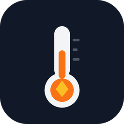

# 🔥 FlueGuard – Rauchgasüberwachung für Holzöfen



**FlueGuard** ist eine HACS-Integration für Home Assistant, die einen beliebigen
Temperatursensor an deinem Ofen (Kamin-, Kachel-, Koch- oder Pelletofen)
auswertet und daraus erkennt, in welcher
Abbrandphase der Ofen gerade ist – und was du mit der Luftzufuhr tun solltest.

Kein Eingriff in die Feuerung, keine Typprüfung, keine Garantiefrage: FlueGuard
**misst und erinnert**, statt aktiv zu regeln. Damit ist es der sichere erste
Schritt zur effizienten Verbrennung – für ein paar Euro Hardware.

```
Rauchgas 380 °C · Hauptabbrand
→ „Luft drosseln“ · Push aufs Handy
```

> **Status:** v0.1.0 · getestet mit Home Assistant 2025.1 · 21 automatisierte
> Tests (Logik + Integration) · MIT-Lizenz

---

## Inhaltsverzeichnis

1. [Das Problem](#das-problem)
2. [Was FlueGuard macht](#was-flueguard-macht)
3. [Einsparungspotenzial](#einsparungspotenzial)
4. [Ofentypen im Überblick](#ofentypen-im-überblick)
5. [Hardware: womit messen?](#hardware-womit-messen)
   - [ESP32 + Thermoelement (empfohlen)](#esp32--thermoelement-empfohlen)
   - [ESP8266 + MAX6675 (die günstige Variante)](#esp8266--max6675-die-günstige-variante)
   - [„Fleischthermometer“ & fertige Funkthermometer](#fleischthermometer--fertige-funkthermometer)
   - [Einfachste Variante ohne Bohren](#einfachste-variante-ohne-bohren)
   - [Weitere Optionen](#weitere-optionen)
6. [Montage in der Putzklappe](#montage-in-der-putzklappe)
7. [Wärmeverteilung: Ventilatoren automatisch steuern](#wärmeverteilung-ventilatoren-automatisch-steuern)
8. [Sicherheit & Recht](#sicherheit--recht)
9. [Installation über HACS](#installation-über-hacs)
10. [Einrichtung](#einrichtung)
11. [Entitäten & Events](#entitäten--events)
12. [Beispiel-Automationen](#beispiel-automationen)
13. [Wie die Erkennung funktioniert](#wie-die-erkennung-funktioniert)
14. [Tuning & FAQ](#tuning--faq)
15. [Quellen & weiterlesen](#quellen--weiterlesen)
16. [Vor dem Veröffentlichen](#vor-dem-veröffentlichen)
17. [Lizenz & Haftung](#lizenz--haftung)

---

## Das Problem

Ein **scheitbefeuerter** Kamin-, Kachel- oder Kochofen hat keine Regelung.
Die Luftzufuhr stellst du per Hand ein – und ob das gerade richtig ist, merkst
du erst am Feuer, am Holzverbrauch oder am Glanzruß im Schornstein.
(Pelletöfen sind die Ausnahme: Sie regeln sich selbst. Was das für FlueGuard
bedeutet, steht unter [Ofentypen](#ofentypen-im-überblick).)

Die Physik dahinter ist unbarmherzig:

- **Zu viel Luft** → die Wärme geht heiß den Schornstein hoch. Der
  Abgasverlust steigt, der Wirkungsgrad sinkt.
- **Zu wenig Luft** → unvollständige Verbrennung, CO, Ruß, Glanzruß,
  Schornsteinbrandrisiko. Und der Ofen wird nicht richtig warm.
- **Der einzige schnelle Indikator für beides ist die Rauchgastemperatur.**

Kommerzielle Abbrandsteuerungen machen genau das – sie messen die Temperatur
und regeln die Luftklappe automatisch. Systeme wie die
[KBS Feuer Control ASG/ASM](https://www.ofen-schraps.de/kamin-und-kachelofenbau/elektronische-abbrandsteuerung/)
liegen bei 595 € netto zzgl. Einbau und werden vom Ofenbauer eingerichtet. Das ist
sinnvoll – aber erst, wenn man weiß, dass man es braucht.

**FlueGuard ist der günstige, risikofreie Zwischenschritt:** 15–25 € Hardware,
30 Minuten Montage, und du siehst zum ersten Mal, was dein Ofen eigentlich tut.

---

## Was FlueGuard macht

Die Integration liest einen vorhandenen Temperatursensor (ESPHome, Zigbee,
Bluetooth, egal) und berechnet daraus:

| Ausgabe | Bedeutung |
|---|---|
| **Abbrandphase** | `Aus` · `Anzünden` · `Hauptabbrand` · `Ausbrand` |
| **Empfehlung** | `Luft offen lassen` · `Halten` · `Luft drosseln` · `Nachlegen` · `Ausbrennen lassen` |
| **Spitzentemperatur** | Maximum des aktuellen Abbrands – ideal für Statistik |
| **Abbranddauer** | Wie lange das Feuer schon läuft |
| **Temperaturänderung** | °C/min, geglättet – erkennt Anfeuern und Ausbrand |
| **Übertemperatur** | Binärsensor, wenn die Warnschwelle überschritten wird |
| **Abbrand aktiv** | Binärsensor für Automationen (Licht, Dunstabzug, Lüftung) |

Dazu:

- **Push-Benachrichtigungen** (optional) bei „zu heiß“, „drosseln“ und „nachlegen“
  – mit Cooldown, damit das Handy nicht nervt.
- **Events** auf dem HA-Bus für eigene Automationen.
- **Zustand überlebt Neustarts** – ein laufender Abbrand wird wieder aufgenommen.
- **Funktioniert mit °C und °F**, rechnet intern in °C.

FlueGuard regelt **nicht** aktiv. Das ist Absicht – siehe
[Sicherheit & Recht](#sicherheit--recht).

---

## Einsparungspotenzial

### Die Faustformel

Der Wirkungsgrad eines Holzofens wird maßgeblich vom **Abgasverlust** bestimmt.
Grob gilt für Holz im üblichen Betrieb:

> **100 K zu heiße Abgase ≈ 5–7 Prozentpunkte Wirkungsgradverlust.**

Bei 12 % CO₂ im Abgas und 20 °C Raumtemperatur ergibt sich überschlägig:

| Rauchgas | Abgasverlust | Ofenwirkungsgrad ca. |
|---|---|---|
| 250 °C | ~13 % | ~75 % |
| 350 °C | ~19 % | ~69 % |
| 450 °C | ~25 % | ~63 % |
| 550 °C | ~31 % | ~57 % |

*(Absolutwerte hängen von CO₂-Gehalt, Holzfeuchte und Ofentyp ab – die
Relationen sind aber belastbar.)*

### Was das in Holz und Euro bedeutet

Beispiel: 5.000 kWh Nutzwärme pro Jahr aus Holz (typisch für einen 6-kW-Ofen,
der im Winter abends läuft), Brennwert des Holzes ~4 kWh/kg.

| Fahrweise | Rauchgas | Wirkungsgrad | Holzbedarf |
|---|---|---|---|
| dauerhaft mit offener Luft | 450–550 °C | 60–65 % | **1.950–2.100 kg** |
| „nach Gefühl“ | 350–400 °C | 67–70 % | **1.790–1.870 kg** |
| gedrosselt nach Thermometer | 250–320 °C | 72–76 % | **1.640–1.740 kg** |

Das sind **15–20 % weniger Holz** gegenüber der schlechtesten Fahrweise und
**8–10 %** gegenüber „nach Gefühl“. Bei ofenfertigem Holz für ~200 €/t
(≈ 100–130 €/Schüttraummeter) sind das **40–80 € pro Jahr** – bei 25 €
Hardware also nach dem ersten Winter bezahlt.

### Die ehrliche Einordnung

- Die auf Herstellerseiten genannten „bis zu 30 %“ beziehen sich auf eine
  **aktive Regelung** an einem vorher schlecht bedienten Ofen. Mit reiner
  Überwachung sind realistisch **5–15 %** drin, wenn du dein Verhalten
  tatsächlich änderst. Wer schon perfekt heizt, spart 0–5 %.
- Der größte Hebel bleibt **trockenes Holz (< 20 %), Anzünden von oben und
  kleine Auflagen**. FlueGuard macht sichtbar, ob du das einhältst.
- **Zu starkes Drosseln ist auch ein Fehler.** Unter ~180 °C steigt die
  Versottung, es bildet sich Glanzruß, und die Verbrennung wird schmutzig.
  Deshalb warnt die Integration in **beide** Richtungen.

### Was sich nicht in Euro messen lässt

- **Weniger Glanzruß** → geringeres Schornsteinbrandrisiko.
- **Weniger Feinstaub** – relevant, wenn dein Ofen unter die
  1. BImSchV-Stufen fällt oder du nachrüsten musst.
- **Weniger CO** im Aufstellraum.
- **Längere Ofenlebensdauer**, weil Übertemperaturen sichtbar werden.
- **Daten für den Schornsteinfeger**: Wenn du belegen kannst, wie der Ofen
  läuft, lassen sich Fragen zu Wirkungsgrad, Nachrüstung und Abgasweg viel
  konkreter klären.

Der zweite große Hebel neben der Luftzufuhr ist die **Wärmeverteilung mit
Ventilatoren** – dazu weiter unten ein eigener Abschnitt.

---

## Ofentypen im Überblick

FlueGuard ist ofentyp-unabhängig: Es liest nur einen Temperatursensor. Aber
Dynamik, Schwellwerte, Montageort und sinnvolle Zusatztechnik unterscheiden
sich deutlich. Die Defaults sind auf einen **freistehenden Kaminofen mit
Messung nah am Ofen** ausgelegt.

| Ofentyp | Abgas typ. | Dynamik | Sensor am besten | Größter Nutzen |
|---|---|---|---|---|
| Freistehender Kaminofen | 250–500 °C | schnell (Minuten) | Putzklappe / Rauchrohr | Phasen + Ventilator |
| Kachelofen / Grundofen | 120–300 °C | träge (Stunden) | Putzklappe | Überfeuerung erkennen |
| Heizkamin / Kassette / Warmluftofen | 250–450 °C | mittel | Rauchrohr | Warmluft-Ventilator |
| Kochofen / Holzherd | 200–500 °C | schnell, spitzig | Rauchrohr | Herdstatus + Dunstabzug |
| Pelletsofen | 80–250 °C | geregelt | Hersteller-API | unabhängiger Wächter |
| Holzvergaser / Kessel | 150–250 °C | geregelt | vorhandener Fühler | Plausibilitätscheck |
| Offener Kamin | 200–400 °C | schnell | Rauchrohr | nur Sicherheit |
| Gas-/Elektrokamin | – | – | – | nicht sinnvoll |

### Freistehender Kaminofen

Der klassische Fall – und der, für den die Defaults gemacht sind. Stahl- oder
Gusseisenofen mit Sichtscheibe, wenig Speichermasse, schnelle Reaktion.
Hier lohnt der Ventilator am meisten (siehe
[Wärmeverteilung](#wärmeverteilung-ventilatoren-automatisch-steuern)).

- Schwellwerte: Defaults passen.
- Sensor: Putzklappe oder Rauchrohr, möglichst nah am Stutzen.
- Typische Abbranddauer: 45–90 Minuten pro Auflage.

### Kachelofen / Grundofen

Viel Speichermasse, lange Abbrandphasen, oft nur ein oder zwei Abbrände pro
Tag. Das Abgas ist kühler und die Kurve deutlich flacher.

- `ignition_max_minutes` auf **30–45** erhöhen.
- `burnout_rate` auf **−0,3 bis −0,8 °C/min** setzen (weniger negativ).
- `cold_threshold` eher bei **60–80 °C**, weil das Abgas im kalten Zustand
  lange nachwärmt.
- **Ventilator:** wenig sinnvoll für die Wärmeverteilung (der Ofen strahlt),
  aber ein langsamer Deckenventilator hilft gegen Wärmestau unter der Decke.
  Keine kalte Luft direkt auf die Kacheln blasen – Thermospannung kann
  Risse begünstigen.
- Nutzen: erkennen, ob zu heiß oder zu lange mit offener Luft gefeuert wurde –
  gerade weil man den Abbrand nicht direkt sieht.

### Heizkamin / Kaminkassette / Warmluftofen

Hier ist die Wärmeabgabe **konvektiv**, oft über Kanäle oder einen
Wärmetauscher. Das ist der Ofentyp, bei dem die Ventilatorsteuerung den
größten Unterschied macht.

- Sensor im Rauchrohr oder in der Putzklappe.
- Warmluftkanäle: nur zugelassene Bauteile, Brandschutzklappen und
  Temperaturgrenzen beachten. Der Ventilator darf nicht die einzige Kühlung
  sein – bei Ausfall muss die Wärme anders abgeführt werden können.
- FlueGuard kann den Kanalventilator phasen- und temperaturabhängig steuern
  (Beispiel unten).

### Kochofen / Holzherd

Kochen und Heizen in einem. Die Abgastemperatur ist hoch und schwankt stark,
weil ständig nachgelegt oder die Herdplatte abgedeckt wird.

- Sensor im Rauchrohr, nicht in der Herdplatte (das ist eine andere Temperatur).
- FlueGuard zeigt „Herd auf Temperatur“ und „Ausbrand“ – praktisch, wenn man
  nebenbei kocht.
- **Dunstabzug:** kritisch. Eine Abzugshaube kann dem Schornstein die Luft
  wegziehen und den Ofen rückwärts ziehen lassen. Nur mit
  Differenzdruckwächter / Fensterkontaktschaltung betreiben – das ist keine
  Bastelei, sondern Sicherheitsrelevanz.
- Ventilator: Küchenlüftung nur mit Freigabe, nie während der Ofen schwelt.

### Pelletsofen

Pelletöfen bringen ihre eigene Regelung mit: Zufuhr, Luft und Zündung laufen
automatisch, viele Modelle haben WLAN, App oder Modbus. FlueGuard ist hier
**kein Ersatz**, sondern ein unabhängiger Wächter.

- Sinnvoll: Abgastemperatur als Plausibilitätscheck („läuft der Ofen wie
  erwartet?“, „Feedstörung?“), Übertemperatur, Betriebsstunden.
- Besser zuerst die Herstellerdaten in Home Assistant holen (Modbus, API,
  Cloud) und FlueGuard nur als zweiten Kanal nutzen.
- Die Phasenlogik („nachlegen“) ist beim Pelletsofen sinnlos – der Ofen
  entscheidet selbst. Schwellwerte entsprechend hoch setzen oder die
  Empfehlungen ignorieren.

### Holzvergaser / Zentralkessel

Hier gibt es bereits Lambdaregelung, Pufferspeicher und meist einen
Abgastemperaturfühler. FlueGuard kann deren Werte auslesen und visualisieren,
aber keine Regelung übernehmen.

- Typische Abgastemperatur: 150–250 °C.
- Wirkungsgrad misst man wasserseitig mit einem Wärmemengenzähler, nicht über
  die Abgastemperatur.
- Nutzen: Überwachung, Statistik, Alarm bei ungewöhnlich hoher Abgastemperatur
  (z. B. Wärmetauscher verrußt).

### Offener Kamin

Kein geschlossener Feuerraum, schlechter Wirkungsgrad, hohe Emissionen. Für
Effizienzversprechen ist das der falsche Ofen. FlueGuard kann hier nur
Sicherheitsüberwachung leisten („Feuer noch an?“), keine Einsparung.

### Gas- und Elektrokamin

Ein Elektrokamin hat kein Rauchgas – hier ist nur die Raumtemperatur
interessant. Gasöfen sind meist raumluftunabhängig und geregelt; Eingriffe
gehören in die Hand des Fachbetriebs. FlueGuard ist dafür nicht gedacht.

> **Kurz gesagt:** Kaminofen = Defaults + Ventilator. Kachelofen = langsamer
> und kühler einstellen. Heizkamin/Warmluft = Ventilatorsteuerung ist der
> Hauptgewinn. Kochofen = Abgas + Dunstabzug-Interlock. Pellet/Kessel = lieber
> die vorhandenen Daten lesen und FlueGuard als Wächter nutzen.

---

## Hardware: womit messen?

### Übersicht

| Lösung | Kosten | Max. Temp. | HA-fähig | Aufwand | Empfehlung |
|---|---|---|---|---|---|
| ESP32 + MAX31855 + Typ-K | 15–25 € | 600–900 °C | ✅ ESPHome | 30–60 min | ⭐ **erste Wahl** |
| ESP32 + MAX31865 + PT100 | 20–35 € | 400–600 °C | ✅ ESPHome | 45–90 min | sehr genau, etwas teurer |
| BBQ-/Fleischthermometer mit App | 30–80 € | oft nur 250–300 °C | ⚠️ meist nein | 10 min | nur als Test |
| Analoges Rauchgasthermometer | 15–25 € | 500 °C | ❌ | 5 min | als Backup/Gegenprobe |
| IR-Thermometer aufs Rauchrohr | 20–40 € | – | ❌ | 1 min | misst nur Oberfläche |

### ESP32 + Thermoelement (empfohlen)

Das ist die Lösung, die in Preis, Genauigkeit und HA-Integration klar gewinnt.

**Teileliste**

| Teil | Bemerkung | Preis |
|---|---|---|
| ESP32 DevKit (z. B. ESP32-WROOM) | reicht völlig, USB-Netzteil dabei | 5–8 € |
| MAX31855-Breakout | SPI, Kaltstellenkompensation, 0–1800 °C | 4–7 € |
| Typ-K-Mantelthermoelement | 1.4571/Inconel, **min. 600 °C**, 6 mm Ø, 150–300 mm lang, 1–2 m Silikon-/Glasfaserleitung | 8–15 € |
| Metall-Kabelverschraubung M20 + Ofenkitt/HT-Silikon (1200 °C) | für die Putzklappe | 5 € |
| Kleingehäuse + 5-V-USB-Netzteil | Elektronik **außerhalb** der Hitze | 5 € |

**Alternativen zum MAX31855:** MAX6675 (billiger, 0–1024 °C, etwas langsamer)
oder MAX31856 (präziser, mehr Aufwand). Wer noch eine PT100/PT1000 liegen hat:
MAX31865 funktioniert genauso gut.

**Verdrahtung (MAX31855 → ESP32)**

```
VIN   → 3V3
GND   → GND
DO    → GPIO19   (MISO)
CS    → GPIO5
CLK   → GPIO18   (SCK)
```

Wichtig:

- **Typ-K-Ausgleichsleitung verwenden**, keine Kupferleitung. Sonst misst du
  die Temperatur der Klemme, nicht des Ofens.
- **Polarität beachten** (Plus = rot bei Typ K, aber Hersteller prüfen).
- Das Breakout ist nur bis ~85 °C Umgebungstemperatur spezifiziert – also in
  ein Gehäuse **abseits** des Ofens, mindestens 30 cm weg von heißen Flächen.
- Die Leitung zur Putzklappe mit **Glasfasermantel** oder Edelstahlgeflecht
  führen, nicht mit PVC.

**ESPHome-Konfiguration** (vollständig in
[`examples/esphome-max31855.yaml`](examples/esphome-max31855.yaml)):

```yaml
spi:
  clk_pin: GPIO18
  mosi_pin: GPIO23
  miso_pin: GPIO19

sensor:
  - platform: max31855
    name: "Rauchgas Temperatur"
    cs_pin: GPIO5
    update_interval: 5s
    filters:
      - median:
          window_size: 5
          send_every: 5
      - clamp:
          min_value: -20
          max_value: 900
```

Danach in Home Assistant: **Einstellungen → Geräte & Dienste → Integration
hinzufügen → FlueGuard** und `sensor.kamin_rauchgas_temperatur` auswählen.
Fertig.

**Kalibrierung:** Thermoelemente haben typisch ±2,5 °C oder 0,75 % Toleranz.
Für die Phasenerkennung völlig irrelevant. Wenn du absolute Werte willst:
Vergleichsmessung mit einem Referenzthermometer bei niedriger Temperatur und
`offset:` im ESPHome-Sensor setzen, oder die Abweichung später in FlueGuard
über die Schwellwerte ausgleichen.

### ESP8266 + MAX6675 (die günstige Variante)

Wenn du noch einen ESP8266 (D1 mini, NodeMCU) liegen hast, reicht auch der
ältere **MAX6675** statt MAX31855. In der simon42-Community läuft genau diese
Kombination erfolgreich in der Putzklappe – inklusive Holzverbrauchsschätzung
über die Betriebsstunden.

**Verdrahtung (MAX6675 → ESP8266)**

```
VCC   → 3V3
GND   → GND
SCK   → GPIO14 (D5)
CS    → GPIO15 (D8)
SO    → GPIO12 (D6)
```

**ESPHome** (vollständig in
[`examples/esphome-max6675-esp8266.yaml`](examples/esphome-max6675-esp8266.yaml)):

```yaml
spi:
  clk_pin: GPIO14

sensor:
  - platform: max6675
    name: "Abgastemperatur Holzofen"
    cs_pin: GPIO15
    update_interval: 10s
```

Unterschiede zum MAX31855:

| | MAX6675 | MAX31855 |
|---|---|---|
| Auflösung | 0,25 °C | 0,25 °C |
| Messbereich | 0–1024 °C | −270…1800 °C |
| Schnittstelle | SPI, nur Lesen | SPI, mehr Diagnose |
| Preis | ~2–3 € | ~4–7 € |
| Fehlerdiagnose | keine | OC/SCG/SCV |

Für Rauchgas bis 600 °C reicht der MAX6675 vollkommen. Nimm den MAX31855,
wenn du Fehlerdiagnose und etwas Reserve willst.

> **Kabel verlängern:** Kurze Verlängerungen mit normalem Kupferdraht
> funktionieren oft, solange beide Kontaktstellen dieselbe Temperatur haben
> (die Gegenstelle kompensiert sich dann). Sauberer und bei langen Wegen
> Pflicht: **Typ-K-Ausgleichsleitung**. Das MAX6675-Board muss außerhalb der
> Hitze sitzen, weil dort die Kaltstellenkompensation stattfindet.

### „Fleischthermometer“ & fertige Funkthermometer

Die Idee liegt nahe: Es gibt günstige BBQ-/Fleischthermometer mit
Bluetooth, App und teils Home-Assistant-Anbindung. Warum es trotzdem meist
nicht funktioniert:

| Problem | Details |
|---|---|
| **Temperaturbereich** | Die mitgelieferten Einstichfühler sind oft nur bis 250–300 °C dauerfest. Im Rauchgas sind 400–600 °C normal. |
| **Material** | Kunststoffgriffe, PVC-Kabel, ungeeignete Dichtungen – im Dauerbetrieb am Schornstein ein Sicherheitsrisiko. |
| **Anbindung** | Viele Geräte sind **app-only** (Cloud/BLE ohne offene API). Ohne HA-Integration bleibt nur die Hersteller-App. |
| **Genauigkeit** | Im Bereich 300–600 °C sind die Billigfühler oft deutlich schlechter als ein 10-€-Typ-K-Element. |
| **Dauerbetrieb** | Die App-Thermometer sind für 2 Stunden Grillabend gebaut, nicht für 10 Jahre Schornstein. |

**Was trotzdem geht:**

- **Inkbird** hat einzelne Geräte mit lokaler BLE-Anbindung, für die es
  HA-Integrationen gibt. Achte aber auf den Messbereich: Die Raumfühler
  (IBS-TH-Serie) hören bei 60 °C auf – für Rauchgas unbrauchbar.
- **ThermoPro / Meater & Co.** liefern meist nur über die Hersteller-Cloud.
  Meater misst zudem die Kerntemperatur und ist für 275 °C Umgebung ausgelegt –
  nicht für Abgas.
- **Als temporäre Gegenprobe** ist so ein Gerät okay: einmal 30 Minuten mit
  einem Grillfühler im Rauchrohr messen, um zu sehen, ob die eigene
  ESP-Lösung plausible Werte liefert. Dauerhaft würde ich es nicht einbauen.

**Fazit:** Für 15 € mehr bekommst du mit ESP32 + MAX31855 + Typ-K eine Lösung,
die für genau diesen Zweck gebaut ist. Die „Fleischthermometer“-Variante ist
eine Bastellösung mit unklarer Lebensdauer.

### Einfachste Variante ohne Bohren

Nicht jeder darf oder will die Putzklappe anbohren – Mietwohnung, denkmalgeschützter
Kachelofen, oder einfach Respekt vor der Abgasanlage. Für einen reinen
**„Nachlegen“-Reminder** reicht ein Raumtemperatursensor in der Nähe des Ofens.

Der Ansatz aus dem
[simon42-Community-Thread](https://community.simon42.com/t/kamin-erinnerung-nachzulegen/30026/19):
Ein Sensor über der Ofentür (dort bleiben die Temperaturen unter ~60 °C) und
eine Trend-Erkennung. Fällt die Temperatur innerhalb von 30 Minuten um
~2 °C, ist der Abbrand am Ausgehen.

```yaml
binary_sensor:
  - platform: trend
    sensors:
      kamin_kuehlt_ab:
        friendly_name: "Kamin kühlt ab"
        entity_id: sensor.kamin_raumtemperatur
        max_samples: 60
        sample_duration: 1800   # 30 Minuten bei 30-s-Updates
        min_gradient: -0.001    # ≈ -2 °C in 30 Minuten
```

```yaml
automation:
  - alias: "Kamin: Nachlegen erinnern"
    trigger:
      - platform: state
        entity_id: binary_sensor.kamin_kuehlt_ab
        to: "on"
        for: "00:10:00"
    condition:
      - condition: state
        entity_id: binary_sensor.kamin_abbrand_aktiv
        state: "on"
      - condition: state
        entity_id: input_boolean.nachlegen_quittiert
        state: "off"
    action:
      - service: notify.mobile_app_handy
        data:
          title: "Kamin: Nachlegen?"
          message: "Die Temperatur fällt – wenn noch Glut da ist, jetzt nachlegen."
```

**Quittieren:** Ein Funkbutton oder NFC-Tag neben dem Ofen setzt
`input_boolean.nachlegen_quittiert` für 5 Minuten auf `on`, damit nach dem
Auflegen nicht sofort wieder erinnert wird. Genau so löst es der Thread-Ersteller
mit seiner Sprachausgabe.

**Grenzen dieser Variante:**

- Sie erkennt nur „es wird kalt“, nicht **wie effizient** der Ofen brennt.
- Die Raumtemperatur wird von Heizung, Fensterlüftung und Sonne überlagert.
- Der Sensor darf nicht zu nah an den Ofen – viele Raumfühler enden bei 60 °C.
- Keine absolute Rauchgastemperatur, also kein Wirkungsgrad und keine
  Übertemperaturwarnung.

Für „einfach nur erinnern“ ist das trotzdem ein guter Einstieg – und später
kannst du jederzeit auf einen Fühler in der Putzklappe aufrüsten.

### Weitere Optionen

- **PT100/PT1000 + MAX31865**: sehr linear, im Bereich 0–600 °C genauer als
  Typ K, aber teurer und die Fühler sind mechanisch empfindlicher.
- **MLX90614 (Infrarot, berührungslos)**: misst die Oberfläche des Rauchrohrs
  aus 5–15 cm Entfernung, I2C, Objekttemperatur bis ~380 °C. Vorteil: **kein
  Bohren**. Nachteile: Emissivität von Ruß/Edelstahl ist unbekannt (→
  kalibrieren), Verschmutzung, Abstand muss stimmen, und es ist eben nur die
  Rohroberfläche, nicht das Gas. Für die Phasenerkennung brauchbar, für
  absolute Werte nicht. Wird in der Community genau dafür eingesetzt.
- **Hochtemperatur-NTC** (z. B. 100 kΩ, bis 300–400 °C) an ESPHome `ntc`:
  billig, aber nichtlinear und die Auswahl ist unübersichtlich.
- **4–20-mA-Messumformer**: für lange Leitungen und industrielle Fühler,
  braucht aber einen ADC/Eingang (z. B. Shelly Add-on, ESP32 mit ADC-Modul).
- **Zigbee/Z-Wave**: Es gibt kaum bezahlbare Hochtemperatursensoren. Wer
  trotzdem Zigbee will, nimmt einen ESP32 als Zigbee-Sensor oder eine
  ESPHome-Bridge.
- **Vorhandene Ofensteuerung mit Lambdasonde**: Wenn dein Ofen schon eine
  Regelung hat, lies deren Temperatur aus (Modbus/HTTP) und speise sie in
  FlueGuard ein – dann bekommst du die Empfehlungsebene zusätzlich.

> **Wichtig:** Ein auf das Rauchrohr geklemmter Oberflächenfühler misst die
> **Rohrwand**, nicht das Gas. Die Werte liegen je nach Rohr, Dämmung und
> Luftzug 100–200 K unter der echten Rauchgastemperatur. Für die
> Phasenerkennung reicht das (die Kurvenform stimmt), für absolute
> Wirkungsgrad-Aussagen nicht.

### Weitere Ideen (Bonus)

Was sich mit FlueGuard kombinieren lässt, ohne die Integration zu ändern:

- **Türkontakt am Ofen** (`binary_sensor`): erkennt „Tür offen“ und bestätigt
  die Anzündphase. Praktisch für die Automation „Licht dimmen, wenn Tür auf“.
- **CO-Melder mit potentialfreiem Kontakt**: zweiter Sicherheitskanal. Wenn CO
  anschlägt und gleichzeitig ein Abbrand läuft → sofort lüften und Feuer
  kontrolliert ausbrennen lassen.
- **Außentemperatur & Wind** in die Auswertung nehmen: Der Schornsteinzug
  hängt stark davon ab. Bei −10 °C und Wind zieht derselbe Ofen deutlich
  heißer als bei +5 °C. Ein Diagramm „Rauchgas vs. Außentemperatur“ erklärt
  scheinbar unerklärliche Unterschiede.
- **Wärmemengenzähler** bei wasserführenden Öfen: Dann kannst du den
  tatsächlichen Wirkungsgrad (kWh Wärme / kg Holz) messen, statt ihn zu
  schätzen. FlueGuard liefert die Abgasdaten dazu.
- **Breitband-Lambdasonde** (nur für Fortgeschrittene): echte
  Verbrennungsluftzahl statt Temperatur-Proxy. Teuer, kalibrierbedürftig und
  für Kaminöfen kaum als Bausatz verfügbar – aber die „richtige“ Lösung, wenn
  man wirklich regeln will.
- **Kamera/OCR auf ein analoges Rauchgasthermometer**: Spielerei, aber witzig
  für Leute, die noch ein altes Zeigerthermometer am Ofen haben.

---

## Montage in der Putzklappe

Deine Idee ist gut – und sie ist der eleganteste Weg, weil man weder am Ofen
noch am Rauchrohr etwas sichtbar verändern muss. Die Putzklappe ist die
Reinigungsöffnung der Abgasanlage; dort herrscht echte Rauchgastemperatur.

### Warum Putzklappe?

- **Echte Abgastemperatur** statt Oberflächentemperatur.
- **Unsichtbar**: kein Kabel am Wohnzimmerofen, keine Bohrung im Sichtbereich.
- **Funktioniert auch beim Kachel-/Grundofen**, wo man nicht ans Rauchrohr kommt.
- **Nachrüstbar ohne Schweißen**, mit einer Kabelverschraubung.

### Der wichtige Unterschied zur kommerziellen Lösung

Die KBS-Steuerung misst **im Feuerraum**. Deine Messung in der Putzklappe ist
weiter weg vom Feuer und damit:

- **kühler** (das Abgas kühlt auf dem Weg ab),
- **träger** (die Wand und das Thermoelement brauchen ein paar Sekunden),
- **abhängig vom Abgasweg** (bei langer Leitung deutlich kühler).

Für die Phasenerkennung ist das kein Problem – die **Form** der Kurve bleibt
gleich. Aber die Default-Schwellwerte (100/150/180/250/350/450 °C) sind auf
eine Messung **nah am Ofen** ausgelegt. Miss deshalb die ersten 2–3 Abbrände
und passe die Schwellwerte an:

> **Faustregel:** Wenn dein Sensor bei einem richtig guten Abbrand nur
> 200–250 °C zeigt statt 350 °C, zieh alle Schwellwerte um den gleichen Faktor
> nach unten (z. B. `optimal_high` von 350 auf 240). Die *Relationen* bleiben.

### Einbau – Schritt für Schritt

1. **Vorher mit dem Schornsteinfeger sprechen.** Die Abgasanlage ist Teil der
   geprüften Anlage. Frag konkret:
   - Darf ich die Putzklappe für einen Temperaturfühler anbohren?
   - Welche Dichtheit / welches Material wird verlangt?
   - Brauchst du eine Dokumentation oder Abnahme?
   - Muss die Putzklappe weiterhin ohne Werkzeug zu öffnen sein?

   Hol dir die Antwort **schriftlich** (E-Mail reicht) und leg sie zu den
   Ofenpapieren.

2. **Messstelle wählen.** So nah wie möglich am Ofen, aber mit Zugang. Nicht
   direkt hinter eine Richtungsänderung, nicht in die Ecke, nicht in den
   Querschnitt der Reinigungsöffnung.

3. **Bohren.** Loch passend zur Kabelverschraubung (meist M20), entgraten.
   Die Putzklappe muss danach wieder **gasdicht** schließen – sonst tritt CO
   in den Aufstellraum. Das ist der kritischste Punkt der ganzen Montage.

4. **Fühler einsetzen.** Eintauchtiefe ca. **1/3 des Schornsteinquerschnitts**,
   Spitze im Kernstrom, nicht an der Wand. Bei rechteckigen Querschnitten
   mittig. Der Fühler darf die Klappe nicht blockieren.

5. **Abdichten.** Hitzefeste Dichtmasse (Ofenkitt oder HT-Silikon, 1200 °C)
   plus Kabelverschraubung. Keine normalen Gummidichtungen, kein Acryl.

6. **Kabel führen.** Typ-K-Ausgleichsleitung, Glasfaser-/Edelstahlmantel,
   **Tropfschleife** nach unten, damit Kondensat nicht ins Gehäuse läuft.
   Elektronik außerhalb des Schornsteins, Umgebungstemperatur < 60 °C,
   Metallgehäuse.

7. **Dichtheit prüfen.** Abgasfahne beobachten (Kerzen/Räucherstäbchen an der
   Klappe), idealerweise CO-Messung durch den Schornsteinfeger. Wenn es zieht:
   nachdichten.

8. **Erste Messung dokumentieren.** 2–3 Abbrände aufzeichnen, dann Schwellwerte
   in FlueGuard anpassen.

### Wartung

- Der Fühler wird mit der Zeit von Ruß/Condensat belegt → **jährlich reinigen**
  (weich abwischen, nicht kratzen).
- Eine Rußschicht dämpft die Messung und verschiebt die Werte nach unten.
  Nach der Reinigung ggf. Offset prüfen.
- Die Putzklappe bleibt Reinigungsöffnung – der Fühler darf das Kehren nicht
  behindern. Im Zweifel Fühler zur Reinigung abziehen (Stecker außerhalb).

---

## Wärmeverteilung: Ventilatoren automatisch steuern

Ein Holzofen gibt Wärme auf zwei Wegen ab: **Strahlung** (direkt, nur in
Sichtlinie) und **Konvektion** (Luft, die am Ofen aufsteigt). Die warme Luft
sammelt sich unter der Decke, während es am Boden kalt bleibt. Ein Ventilator
verteilt sie – und kühlt gleichzeitig den Ofenkörper, wodurch mehr Wärme in den
Raum und weniger ins Abgas geht.

Das ist der zweitgrößte Hebel nach der Luftzufuhr. Wichtig: **nicht zu stark
kühlen**, sonst sinkt die Rauchgastemperatur in den Bereich, in dem sich
Glanzruß bildet.

### Welcher Ventilator passt?

| Typ | Strom | HA-Steuerung | Geeignet für |
|---|---|---|---|
| Thermoelektrischer Ofenventilator | keiner (Peltier) | ❌ | Kaminofen, einfacher Einstieg |
| Raumventilator an Smart Plug | 230 V | ✅ an/aus | freistehender Ofen |
| EC-/PWM-Ventilator | 12/24 V | ✅ stufenlos | Warmluftkanäle, Heizkamin |
| Deckenventilator | 230 V | ✅ | Wärmestau unter der Decke |
| Kanalventilator | 230 V | ✅ | Warmluftofen (Fachbetrieb!) |
| Kontrollierte Wohnraumlüftung | 230 V | ✅ | ganzes Haus, balanced |

Der **thermoelektrische Ofenventilator** ist die einfachste Lösung: Er startet
bei ~50–60 °C von selbst, regelt die Drehzahl über die Temperatur und braucht
keinen Stromanschluss. Für „einfach nur verteilen“ völlig ausreichend – aber
er ist nicht in Home Assistant sichtbar und nicht abschaltbar.

**12-V-Ventilator stufenlos per ESPHome** (für Bastler):

```yaml
output:
  - platform: ledc
    pin: GPIO25
    id: fan_pwm
    frequency: 25000 Hz

fan:
  - platform: speed
    output: fan_pwm
    name: "Ofen Ventilator"
```

Wichtig: Ein 12-V-Lüfter gehört **nicht** direkt an den GPIO, sondern über
einen MOSFET oder ein Treibermodul. Der ESP liefert nur das PWM-Signal.

### Die Steuerlogik

Eine gute Ventilatorautomatik arbeitet mit **Phase + Rauchgastemperatur +
Raumtemperatur**, nicht mit einer festen Einschalttemperatur.

| Bedingung | Ventilator |
|---|---|
| Kein Abbrand (`idle` / `burnout`) | aus (nach 10–15 min Nachlauf) |
| `ignition` / `main`, Rauchgas 140–300 °C | 20–80 % linear |
| Rauchgas > 350 °C | 80–100 % |
| Rauchgas > Warnschwelle (450 °C) | 100 % Notkühlung |
| Rauchgas < 140 °C | aus (Glanzruß vermeiden) |
| Raumtemperatur über Wunsch | Leistung reduzieren |
| Nachtmodus 22–7 Uhr | max. 30 % |
| Manueller Boost | 100 % für 20 min |

Wichtig ist die **Mindesttemperatur**: Ein Ventilator, der den Ofen bei
150 °C Rauchgas weiter kühlt, verschiebt den Taupunkt und fördert
Ablagerungen. Deshalb läuft er nur, solange der Ofen wirklich heiß ist.

### Beispiel-Automation

Vollständig in [`examples/fan-control.yaml`](examples/fan-control.yaml).
Der Kern:

```yaml
- alias: "Ofen: Ventilator nach Rauchgastemperatur"
  trigger:
    - platform: state
      entity_id: sensor.kamin_rauchgastemperatur
    - platform: state
      entity_id: binary_sensor.kamin_abbrand_aktiv
      to: "on"
  condition:
    - condition: state
      entity_id: binary_sensor.kamin_abbrand_aktiv
      state: "on"
    - condition: numeric_state
      entity_id: sensor.kamin_rauchgastemperatur
      above: 140
  action:
    - variables:
        temp: "{{ states('sensor.kamin_rauchgastemperatur') | float(0) }}"
        pct: >-
          
          {{ [85, [15, p] | max] | min | round(0) | int }}
    - service: fan.set_percentage
      target:
        entity_id: fan.ofen_ventilator
      data:
        percentage: "{{ pct }}"
  mode: single
```

Dazu eine Ausschalt-Automation mit Nachlauf und eine Notkühlung bei
Übertemperatur. Wer nur einen Smart Plug hat, ersetzt `fan.set_percentage`
durch `switch.turn_on` und lässt die Rampe weg.

### Sicherheitsregeln

- Der Ventilator bewegt **Raumluft**, nicht die Verbrennungsluft. Nie direkt
  in die Luftansaugung des Ofens blasen – das verändert den Zug.
- Abstand zu heißen Flächen, hitzebeständiges Gehäuse, Kabel nicht über den
  Ofen führen. Keine Billig-Plastikventilatoren direkt am Rauchrohr.
- Der Ventilator ist **keine** Sicherheitseinrichtung. Übertemperatur muss
  zusätzlich akustisch/visuell gemeldet werden.
- **Dunstabzug und zentrale Absaugung** können den Schornstein umkehren. In
  dichten Häusern Differenzdruckwächter oder Fensterkontaktschaltung
  vorsehen – das ist Fachbetriebsarbeit.
- **Warmluftkanäle**: nur zugelassene Bauteile, Brandschutzklappen,
  Temperaturgrenzen. Ein Kanalventilator darf nicht die einzige Kühlung sein.
- **Kachelofen**: keine kalte Luft direkt auf die Kacheln blasen
  (Thermospannung). Lieber langsam die Raumluft umwälzen.

### Was bringt es wirklich?

- **Komfort:** deutlich gleichmäßigere Wärme, warme Füße, weniger
  „Hitze-Kopf“ unter der Decke.
- **Effizienz:** Ein Ventilator über dem Ofen kann die Rauchgastemperatur um
  **20–50 K** senken, weil mehr Wärme an den Raum abgegeben wird. Das sind
  grob **2–5 %** Holz – kein Wundermittel, aber spürbar.
- **Überhitzungsschutz:** Bei zu heißem Ofen kann der Ventilator die
  Oberflächentemperatur senken, bevor der Ofen Schaden nimmt.

Der schöne Nebeneffekt: Mit FlueGuard kannst du den Effekt **messen** –
Rauchgastemperatur mit und ohne Ventilator vergleichen, und du siehst sofort,
ob deine Einstellung wirklich etwas bringt.

---

## Sicherheit & Recht

**FlueGuard ist eine Anzeige, keine Regelung.** Das ist kein Zufall:

- Ein Eingriff in die Luftführung eines typgeprüften Ofens (DIN EN 13240 /
  DIN EN 13229) berührt die Bauartgenehmigung. Das kann die Betriebserlaubnis,
  den Versicherungsschutz und die Abnahme durch den Schornsteinfeger kosten.
- Eine Automatik, die Luft schließt, ohne die Verbrennung wirklich zu kennen,
  kann CO erzeugen. Ein Servo, der klemmt oder stromlos zufährt, ist
  lebensgefährlich.
- Deshalb: **keine Automation, die auf Basis dieser Sensoren die Luft
  schließt.** Die Empfehlung ist ein Hinweis an den Menschen, der davor steht.

Weitere Punkte:

- **1. BImSchV** und die regionale Kehr- und Überprüfungsordnung gelten
  weiterhin. Ein zusätzlicher Fühler ändert daran nichts, solange die Anlage
  dicht und unverändert bleibt.
- **Aufstellabstände** nach Herstellerangabe: typisch mindestens 20 cm zu
  Seitenwänden (bei Sichtfenstern mehr), 80 cm zu Möbeln und eine
  Bodenplatte, die seitlich ~30 cm und nach vorn ~50 cm übersteht. Die
  Herstellerangaben haben Vorrang – das ist keine Empfehlung, sondern
  Brandschutz.
- **CO-Melder** in den Aufstellraum – 20–30 €, unabhängig von diesem Projekt.
  Besonders wichtig, wenn die Putzklappe im Wohnraum liegt.
- **Sekundärluft bleibt offen.** Sie ist für die Nachverbrennung und die
  Glasfreispülung zuständig. Drosseln darf man die Primärluft.
- **230 V** nur durch eine Elektrofachkraft. Der ESP32 läuft mit 5 V USB.
- **Keine Änderung an Brennkammer, Dichtungen oder Abgaswegen.**
- **Versicherung**: Frag bei Umbauten an der Abgasanlage nach, ob der Schutz
  erhalten bleibt.

---

## Installation über HACS

### Voraussetzungen

- Home Assistant **2025.1** oder neuer
- HACS installiert
- Ein Temperatursensor, der die Rauchgastemperatur liefert (siehe oben)

### Variante A: HACS (empfohlen)

1. **HACS → Integrationen → ⋮ → Benutzerdefinierte Repositories**
2. URL dieses Repositories eintragen, Kategorie **Integration**
3. **FlueGuard** suchen → **Herunterladen**
4. Home Assistant neu starten
5. **Einstellungen → Geräte & Dienste → Integration hinzufügen → FlueGuard**

### Variante B: manuell

```bash
cd /config
git clone <repo-url> /tmp/flueguard
cp -r /tmp/flueguard/custom_components/flueguard /config/custom_components/
```

Danach Neustart und Integration hinzufügen.

### Updates

HACS zeigt Updates automatisch an. Nach dem Update Home Assistant neu starten.

---

## Einrichtung

### Assistent

| Feld | Bedeutung |
|---|---|
| **Rauchgas-Temperatursensor** | Der Sensor, der die Temperatur liefert. Jeder `sensor` mit Zahlenwert und °C/°F funktioniert. |
| **Abfrageintervall** | Standard 30 s. Kürzer = schnellere Reaktion, mehr Datenbankeinträge. |
| **Benachrichtigungen** | Push bei Übertemperatur, „drosseln“ und „nachlegen“. |
| **Notify-Service** | z. B. `notify.mobile_app_handy` (mit oder ohne `notify.`). |

### Optionen (nachträglich änderbar)

Unter **Einstellungen → Geräte & Dienste → FlueGuard → Konfigurieren**:

| Option | Default | Bedeutung |
|---|---|---|
| `cold_threshold` | 100 °C | Darunter gilt der Ofen als kalt (Abbrand beginnt/endet). |
| `refuel_threshold` | 150 °C | Darunter macht Nachlegen Sinn – **wenn noch Glut da ist**. |
| `optimal_low` | 180 °C | Unterkante des guten Bereichs. |
| `main_threshold` | 250 °C | Ab hier gilt der Hauptabbrand als etabliert. |
| `optimal_high` | 350 °C | Oberkante des guten Bereichs. |
| `warn_threshold` | 450 °C | Warnschwelle / „zu heiß“. |
| `ignition_max_minutes` | 15 min | Nach dieser Zeit geht die Anzündphase in Hauptabbrand über. |
| `burnout_rate` | −1,5 °C/min | Ab dieser Abkühlrate beginnt der Ausbrand. |

Die Reihenfolge muss aufsteigend sein, sonst lehnt der Assistent die Eingabe ab.

### Erste Schritte nach der Installation

1. **2–3 Abbrände normal heizen** und den Verlauf beobachten.
2. Prüfen: Kommen die Phasen plausibel? (`Anzünden` → `Hauptabbrand` → `Ausbrand`)
3. Wenn die Temperaturen insgesamt niedriger sind als erwartet (Messung weit
   weg vom Ofen): Schwellwerte proportional nach unten ziehen.
4. Erst dann Benachrichtigungen scharf schalten.

---

## Entitäten & Events

### Sensoren

| Entität | Einheit | Beschreibung |
|---|---|---|
| `sensor.<name>_rauchgastemperatur` | °C | Geglättete, nach °C konvertierte Temperatur |
| `sensor.<name>_temperaturaenderung` | °C/min | Geglättete Änderungsrate |
| `sensor.<name>_abbrandphase` | – | `idle`, `ignition`, `main`, `burnout` |
| `sensor.<name>_empfehlung` | – | `wait`, `air_open`, `hold`, `reduce_air`, `add_fuel`, `let_burn_out` |
| `sensor.<name>_abbranddauer` | s | Laufzeit des aktuellen Abbrands |
| `sensor.<name>_spitzentemperatur` | °C | Maximum des aktuellen Abbrands |

### Binärsensoren

| Entität | Beschreibung |
|---|---|
| `binary_sensor.<name>_abbrand_aktiv` | `on`, solange eine Phase ≠ `idle` ist |
| `binary_sensor.<name>_uebertemperatur` | `on`, wenn `warn_threshold` überschritten |

### Events

Alle Events landen auf dem HA-Bus und enthalten `entry_id`, `source_entity`,
`temperature` und `rate`.

| Event | Zusätzliche Felder |
|---|---|
| `flueguard_phase_changed` | `phase`, `previous` |
| `flueguard_recommendation_changed` | `recommendation`, `previous` |
| `flueguard_overtemperature` | `threshold` |

---

## Beispiel-Automationen

Die vollständigen Dateien liegen unter
[`examples/automations.yaml`](examples/automations.yaml),
[`examples/fan-control.yaml`](examples/fan-control.yaml) und
[`examples/dashboard.yaml`](examples/dashboard.yaml).

### Push-Nachricht bei Übertemperatur

Die Integration kann das selbst – wer volle Kontrolle will, baut es so:

```yaml
automation:
  - alias: "Ofen zu heiß"
    trigger:
      - platform: event
        event_type: flueguard_overtemperature
    action:
      - service: notify.mobile_app_handy
        data:
          title: "🔥 Ofen zu heiß"
          message: >-
            Rauchgas {{ trigger.event.data.temperature }} °C –
            Primärluft drosseln.
          data:
            channel: ofen
            importance: high
```

### Lampe wird rot, wenn gedrosselt werden soll

```yaml
automation:
  - alias: "Ofenampel"
    trigger:
      - platform: state
        entity_id: sensor.kamin_empfehlung
    action:
      - choose:
          - conditions:
              - condition: state
                entity_id: sensor.kamin_empfehlung
                state: "reduce_air"
            sequence:
              - service: light.turn_on
                target:
                  entity_id: light.wohnzimmer
                data:
                  color_name: red
          - conditions:
              - condition: state
                entity_id: sensor.kamin_empfehlung
                state: "add_fuel"
            sequence:
              - service: light.turn_on
                target:
                  entity_id: light.wohnzimmer
                data:
                  color_name: orange
        default:
          - service: light.turn_on
            target:
              entity_id: light.wohnzimmer
            data:
              color_name: warmwhite
```

### Abluft/Dunstabzug sperren, solange der Ofen läuft

```yaml
automation:
  - alias: "Dunstabzug bei Ofenbetrieb aus"
    trigger:
      - platform: state
        entity_id: binary_sensor.kamin_abbrand_aktiv
        to: "on"
    action:
      - service: switch.turn_off
        target:
          entity_id: switch.dunstabzug
```

> ⚠️ Das ersetzt **keinen** Differenzdruckwächter. Dunstabzug und Ofen
> gleichzeitig können den Schornstein umkehren. Im Zweifel Fachbetrieb fragen.

### Dashboard

Eine fertige Karte liegt in [`examples/dashboard.yaml`](examples/dashboard.yaml):

```yaml
type: vertical-stack
cards:
  - type: gauge
    entity: sensor.kamin_rauchgastemperatur
    name: Rauchgas
    min: 0
    max: 600
    severity:
      green: 180
      yellow: 350
      red: 450
  - type: entities
    entities:
      - sensor.kamin_abbrandphase
      - sensor.kamin_empfehlung
      - sensor.kamin_spitzentemperatur
      - sensor.kamin_abbranddauer
      - binary_sensor.kamin_uebertemperatur
  - type: history-graph
    entities:
      - sensor.kamin_rauchgastemperatur
    hours_to_show: 12
```

### Statistik: Holzverbrauch schätzen

`binary_sensor.abbrand_aktiv` in Brennstunden umrechnen und mit dem Durchsatz
deines Ofens (kg/h aus der Bedienungsanleitung, typisch 1,5–3 kg/h)
multiplizieren. Genau so macht es auch der simon42-Thread – dort landet der
geschätzte Verbrauch im Energiedashboard.

```yaml
sensor:
  - platform: history_stats
    name: "Abbrand heute"
    entity_id: binary_sensor.kamin_abbrand_aktiv
    state: "on"
    type: time
    start: "{{ today_at('00:00') }}"
    end: "{{ now() }}"

  - platform: template
    sensors:
      holzverbrauch_heute:
        friendly_name: "Holzverbrauch heute"
        unit_of_measurement: "kg"
        value_template: >-
          {{ (states('sensor.abbrand_heute') | float(0) * 2.0) | round(1) }}
```

`2.0` ist der Durchsatz in kg/h – anpassen. Die Schätzung ist grob
(Holzart, Feuchte, Luftstellung), aber für Trends und Wochenvergleiche sehr
brauchbar.

**Nebeneffekt:** Wenn der Abbrand längst vorbei ist, die Rauchgastemperatur
aber hoch bleibt, wurde die Luftzufuhr vermutlich nicht geschlossen. Auch
dafür gibt es eine Beispiel-Automation in
[`examples/automations.yaml`](examples/automations.yaml).

---

## Wie die Erkennung funktioniert

```
                  ┌──────────────┐
    kalt ────────►│  Anzünden    │  Luft offen lassen
                  └──────┬───────┘
                         │ ≥ main_threshold oder Zeit abgelaufen
                         ▼
                  ┌──────────────┐
                  │ Hauptabbrand │  halten / drosseln / Luft öffnen
                  └──────┬───────┘
                         │ Rate ≤ burnout_rate und ≥ peak − 25 K
                         ▼
                  ┌──────────────┐
                  │   Ausbrand   │  nachlegen oder ausbrennen lassen
                  └──────┬───────┘
                         │ < cold_threshold
                         ▼
                  ┌──────────────┐
                  │     Aus      │
                  └──────────────┘
```

- **Start** bei `cold_threshold + 5 K` (Hysterese gegen Flackern).
- **Rate** wird aus zwei Messpunkten berechnet und exponentiell geglättet
  (70 % alter Wert, 30 % neuer Wert), damit einzelne Ausreißer die Phase
  nicht kippen.
- **Ausbrand** wird erst erkannt, wenn die Temperatur mindestens 25 K unter
  dem Peak liegt **und** die Rate unter −1,5 °C/min fällt. So löst ein kurzer
  Einbruch (Tür auf, Wind) keinen falschen Ausbrand aus.
- **Persistenz**: Phase, Startzeit und Peak werden gespeichert und nach einem
  Neustart wiederhergestellt (max. 24 h alt).

Die Schwellwerte sind bewusst **einfach und erklärbar**. Ein PID-Regler wäre
hier die falsche Antwort – es gibt keinen Stellmotor, und die Physik eines
Holzabbrands ist zu träge und zu nichtlinear für eine sinnvolle Regelung ohne
Luftklappen-Aktor.

---

## Tuning & FAQ

**Mein Sensor zeigt im kalten Zustand 20 °C – ist das richtig?**
Ja. Ein Typ-K-Thermoelement in der Putzklappe misst die Umgebungsluft, solange
kein Feuer brennt. Erst ab ~100 °C beginnt die Erkennung.

**Die Werte springen.**
Bei MAX31855/MAX6675 fast immer ein Verdrahtungsproblem: schlechte
Masseverbindung, zu lange ungeschirmte Leitung, fehlende
Kaltstellenkompensation durch falsche Verlängerung (Kupfer statt Typ-K).
`median`-Filter in ESPHome hilft zusätzlich.

**MAX31855 meldet Fehler (OC/SCG/SCV).**
Open Circuit / Short to GND / Short to VCC – Fühler oder Leitung defekt.
Erst Stecker prüfen, dann Fühler tauschen.

**Warum keine automatische Luftklappe?**
Weil ein Eingriff in die Feuerung die Typprüfung berührt und eine fehlerhafte
Automatik CO erzeugen kann. Wer das trotzdem bauen will, braucht: fail-safe
öffnende Mechanik, harte Temperaturgrenzen im ESP (nicht nur in HA),
Watchdog, mechanische Endanschläge und die Freigabe vom Ofenhersteller.
FlueGuard liefert dafür die Sensorik und die Phasenlogik – die Aktorik ist
bewusst nicht enthalten.

**Kann ich mehrere Öfen überwachen?**
Ja, die Integration einfach mehrfach hinzufügen – jede Instanz bekommt ein
eigenes Gerät und eigene Entitäten.

**Funktioniert das mit °F?**
Ja. Die Integration rechnet intern in °C und zeigt in deiner HA-Einheit an.

**Wie viele Daten landen in der Datenbank?**
Bei 30 s Intervall ~2.880 Zustände/Tag. Wer das nicht will, kann die
Entitäten in `recorder:` ausschließen und nur die Phasen/Events behalten.

**Kann ich die Schwellwerte per Automation ändern?**
Aktuell nur über die Optionen (Konfigurieren). Wenn du das dynamisch brauchst,
leg ein Issue an – oder nutze die Events und baue die Logik in einer
Template-Automation.

**Mein Kachelofen ist viel träger.**
Dann `ignition_max_minutes` erhöhen und `burnout_rate` weniger negativ wählen
(z. B. −0,5 °C/min). Bei Grundöfen dauert der Ausbrand oft Stunden.

---

## Quellen & weiterlesen

Diese Integration und die README sind aus Praxisberichten und Herstellerdaten
zusammengestellt. Die wichtigsten Quellen:

- **[Ofen Schraps – elektronische Abbrandsteuerung](https://www.ofen-schraps.de/kamin-und-kachelofenbau/elektronische-abbrandsteuerung/)**
  – kommerzielle Referenz (KBS Feuer Control ASG/ASM): Fühler im Feuerraum,
  automatische Luftklappe, Herstellerangabe „bis zu 30 %“ Brennholzersparnis,
  ~595 € netto zzgl. Einbau. Guter Maßstab dafür, was eine echte Regelung
  leisten kann.
- **[simon42 Community – Kamin-Erinnerung nachzulegen](https://community.simon42.com/t/kamin-erinnerung-nachzulegen/30026/19)**
  – Praxis-Thread: MAX6675 in der Putzklappe nach Rücksprache mit dem
  Schornsteinfeger, Trend-Erkennung über die Raumtemperatur, Quittier-Taste
  gegen Dauer-Nervigkeit und Holzverbrauchsschätzung über Betriebsstunden.
- **[Info Warren – Wood Stove Automation (Hardware)](https://infowarren.wordpress.com/2024/06/06/wood-stove-automation-hardware/)**
  – ESP8266 + MAX6675, Linearantrieb auf der Luftklappe, Ventilator zur
  Kühlung, Zigbee-Plug – und ein ehrlicher Erfahrungsbericht: Der erste
  Stellantrieb war nach sechs Monaten defekt. Genau deshalb regelt FlueGuard
  nicht.
- **[Otto updated – Intelligente Ofensteuerung](https://www.otto.de/updated/ratgeber/automatische-ofensteuerung-im-smart-home-79071/)**
  – Überblick über smarte Öfen: Pellet, Holz, Gas, Elektro, App-Anbindung und
  Sicherheitsabstände. Zeigt gut, wo Hersteller schon automatisieren (Pellet)
  und wo nicht (Holzscheit).
- **[ESPHome MAX6675](https://esphome.io/components/sensor/max6675.html)** und
  **[MAX31855](https://esphome.io/components/sensor/max31855.html)** –
  Sensor-Dokumentation und Pinbelegung.
- **[Home Assistant Trend-Integration](https://www.home-assistant.io/integrations/trend/)**
  – für die einfache Variante ohne Bohren.

Die Einsparungszahlen in dieser README sind bewusst konservativ und als
Größenordnung gekennzeichnet. Herstellerangaben zu aktiven Regelungen lassen
sich nicht 1:1 auf reine Überwachung übertragen.

---

## Vor dem Veröffentlichen

Wenn du das Repo auf GitHub stellst, sind nur wenige Dinge anzupassen:

1. **`custom_components/flueguard/manifest.json`**
   - `codeowners`: deinen GitHub-Namen eintragen (`@dein-name`)
   - `documentation` und `issue_tracker`: deine Repo-URL
2. **Repo-Themen** setzen: `home-assistant`, `hacs`, `hacs-integration`,
   `wood-stove`, `kaminofen`, `flue-gas`.
3. **Release anlegen** (`v0.1.0`), damit HACS Updates erkennt.
4. Optional: In HACS als Standard-Repository vorschlagen
   (`hacs/default` Pull Request) – dann finden es andere ohne URL.

Die mitgelieferte GitHub Action prüft bei jedem Push Manifest und
HACS-Konformität.

Tests lokal:

```bash
pip install -r requirements_test.txt
pytest
```

---

## Lizenz & Haftung

MIT-Lizenz – siehe [LICENSE](LICENSE). Nutzung auf eigene Gefahr.

**Dieses Projekt ist kein Ersatz für eine fachgerechte Ofenplanung, keine
Abnahme und keine Brandschutzberatung.** Messungen an der Abgasanlage nur nach
Rücksprache mit dem Schornsteinfeger. Die Integration greift nicht in die
Verbrennung ein und darf nicht als Sicherheitseinrichtung verwendet werden.
Für Schäden durch unsachgemäße Montage, falsche Schwellwerte oder
Fehlinterpretationen wird keine Haftung übernommen.
